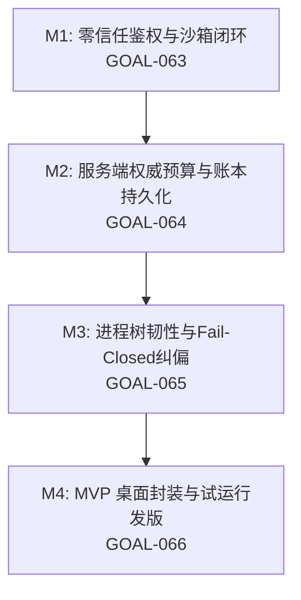

# RM-010：商业化就绪与安全加固路线图 (Commercial Readiness & Security Hardening)

> **前置里程碑**：RM-001 ~ RM-009（55+ 个 Goal 已全部大圆满交付，534 项测试 100% 全绿）  
> **战略定位**：本地授权桌面软件 (Local-Licensed Desktop Software) · 面向个人开发者与极客 · MVP 试运行版先行 (D79)  
> **核心原则**：先修闸门、再讲故事；代码零离机、BYOK 密钥本地持有、全链路可追责审计。

---

## 1. 里程碑规划矩阵 (Milestones)

| 里程碑 | 目标实体 | 核心任务与安全边界 | 预期交付状态 |
| :--- | :--- | :--- | :---: |
| **M1: 核心安全与零信任鉴权** | `GOAL-063` | 1. 强制启用 `callerToken` 鉴权与 `Origin`/CSRF 校验； 2. 废除匿名 `/api/session/token` 领取； 3. 路径沙箱白名单化（`mention-file` 与 `assemble` 拒绝越权读取）； 4. `chat.ts` 强校验 `sessionId` 格式防穿越； 5. ELO 视图全量 `esc()` 转义防存储型 XSS 与数据外传； 6. SVG 附件沙箱隔离。 | 待执行 (READY) |
| **M2: 权威预算与持久化** | `GOAL-064` | 1. `cap_usd` 改为服务端权威配置锁定（客户端只能 $\le$ 服务端配置）； 2. 废除普通接口随意提额旁路； 3. 对接真实 Telemetry / 用量实测数据回写至预算台账； 4. 预算台账从纯内存改造为 Append-Only JSONL 磁盘持久化，重启不丢账。 | 待执行 (READY) |
| **M3: 进程韧性与真实纠偏** | `GOAL-065` | 1. 全局子进程 `child.stdin.on('error')` EPIPE 崩溃防护； 2. Windows 环境 `taskkill /PID /T /F` 进程树收割（杜绝孙进程孤儿遗留）； 3. `pi-rpc-runner` 退出码 0 未完成 Completion 强制 Fail-Closed 纠偏； 4. 审批令牌原子 Rename 消费，杜绝 TOCTOU 并发双花。 | 待执行 (READY) |
| **M4: 桌面打包与试运行发版** | `GOAL-066` | 1. 补充标准开源协议（Apache-2.0）与商用 EULA 责任限制条款； 2. 评估 Node 运行时内嵌打包或 Tauri 2.0 极简单文件桌面壳； 3. 极简本地试运行许可证验证机制； 4. 官方发布材料、文档与体验闭环。 | 待执行 (READY) |

---

## 2. 治理与验收总则

1. **测试即规格**：每个 Goal 必须配备针对性自动化回归测试用例（如 `tests/g063-*.test.ts`），全库 534+ 测试套件必须保持 100% 绿灯。
2. **证据留痕**：每个 Goal 交付执行标准收官（`node scripts/close-goal.cjs <GOAL-ID>`），生成哈希锚定回执。
3. **红线纪律**：坚守纯本地零外部 CDN、零敏感密钥泄露、意向项目只读等核心宪法红线。
