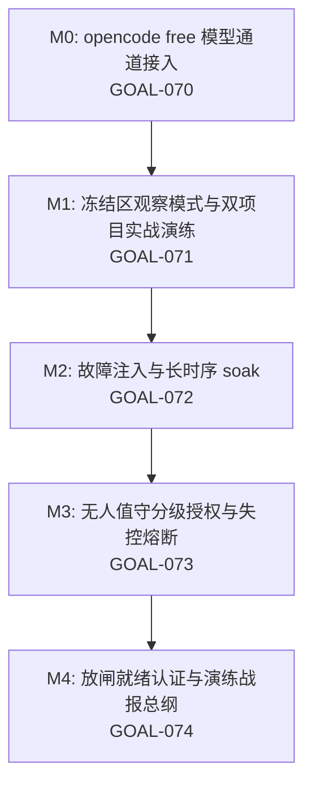

# RM-011：实战淬火与自动化放闸路线图 (Battle-Hardening & Unattended Enablement)

> **前置里程碑**：RM-001 ~ RM-010 全部收官；`v0.1.1-pilot`（576+ 测试全绿 + typecheck 门禁）；多项目隔离热切换引擎（GOAL-068）已交付。  
> **战略定位**：从「机检绿」走向「实战绿」——用真实项目演练验证高危架构变更，以演练证据链为唯一通行证，为 D8（无人值守调度器默认关）的有条件放闸铺路。  
> **核心原则**：先淬火、再放闸；演练证据是放闸唯一通行证；D8 默认值翻转权始终归 owner，本路线图只交付「敢开的证据」。  
> **立项依据**：owner 2026-08-23 规划会批复「RM-011 可以」；靶场方案 B（冻结区观察模式）；M0（opencode free 接入）同步认可。决策记录见 DECISIONS.md D82 批次。

---

## 1. 里程碑规划矩阵 (Milestones)

| 里程碑 | 目标实体 | 核心任务与边界 | 预期交付状态 |
| :--- | :--- | :--- | :---: |
| **M0: opencode free 通道接入** | `GOAL-070` | 1. 发现层接 `opencode models [provider]` 枚举（含 6 个 free 模型与 botcf/pixel/tbtk 转介通道）； 2. 适配器注入 `-m provider/model` 选型（`--variant` 档位契约已有）； 3. live probe 实测身份回执，UNVERIFIED → VERIFIED； 4. free 命名自动落入零成本梯队（GOAL-026 计费生效）。 | READY |
| **M1: 冻结区观察模式与双项目实战演练** | `GOAL-071` | 1. 新增冻结区「观察模式工作区」能力（方案 B）：只读挂载、零写命令白名单、审批卡 OBSERVATION 标注，冻结区内零文件创建（含 .mush）； 2. 双项目实战演练：意向项目（观察态只读）+ 常规真实项目（全写流程）； 3. 真实负载穿越 068 热切换引擎，产出演练战报与缺陷清单。 | READY |
| **M2: 故障注入与长时序 soak** | `GOAL-072` | 1. 犬进程中断恢复 / 服务重启事件回放 / master ledger 并发撕裂追加混沌用例； 2. 8h+ 长 soak 用 M0 free 模型零成本执行； 3. 内存/句柄增长观测基线。 | READY |
| **M3: 无人值守分级授权与失控熔断** | `GOAL-073` | 1. 分级档位：L0 全弹卡（现状）/ L1 低额自动批·超额弹卡 / L2 任务型白名单自动批； 2. 额度硬顶联动 master gate； 3. 失控熔断：连败 N 次、预算斜率异常、超时自停 + 审计回放包。 | READY |
| **M4: 放闸就绪认证与演练战报总纲** | `GOAL-074` | 1. 就绪度 checklist 引擎（证据项全部机检可验）； 2. 一键开启向导 + 风险披露文案； 3. 输出《无人值守放闸就绪认证报告》呈 owner 终裁。 | READY |

---

## 2. 治理与验收总则

1. **测试即规格**：每个 Goal 必须配备针对性自动化回归测试（`tests/g07x-*.test.ts`），全库套件保持 100% 绿灯 + typecheck 零错误门禁。
2. **证据留痕**：每个 Goal 交付执行标准收官（`node scripts/close-goal.cjs <GOAL-ID>`），生成哈希锚定回执；演练战报归档 `docs/dispatch/`。
3. **红线纪律**：
   - 观察模式对冻结区**零写入**（含 `.mush` 元数据），违者即缺陷；
   - 密钥 BYOK 不变，mush 零接触各 harness 凭据；
   - 无人值守能力交付 ≠ 开启：默认值变更必须由 owner 显式裁决。
4. **契约演进**：涉及新端点的 Goal 各自升版 `api-contract.md` 并记录变更条目。
